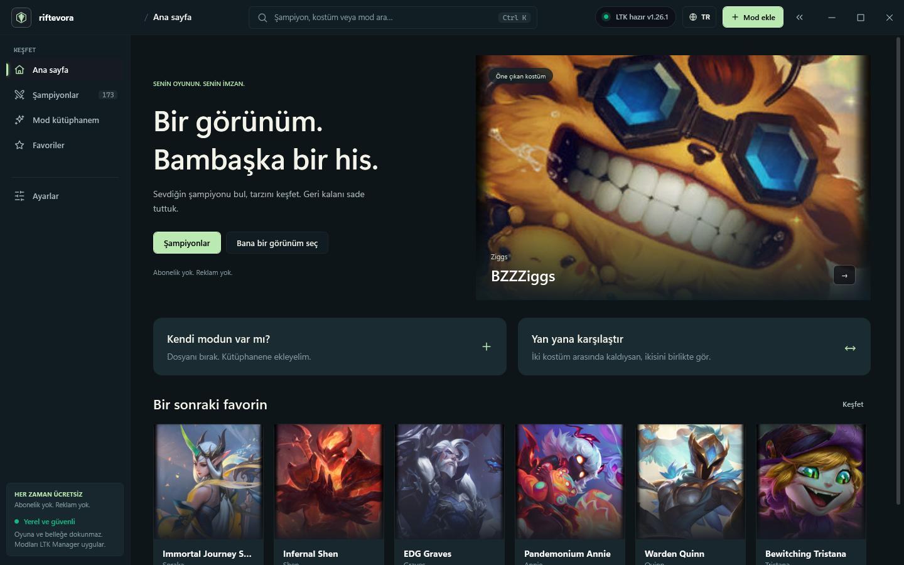
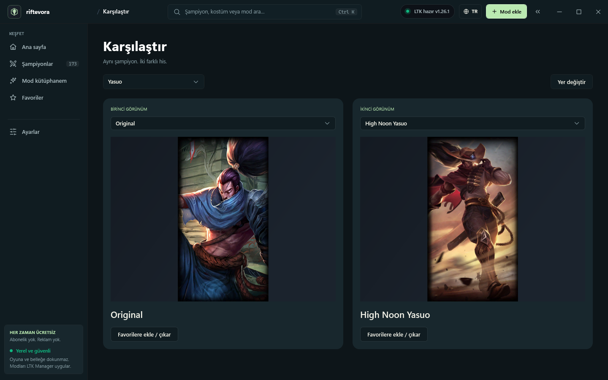

# Riftevora 3.0

A free Windows desktop companion for League of Legends artwork and community mod packages.



## Türkçe

Riftevora; sade bir arayüzde resmi skin görsellerini keşfetmek, iki kostümü yan yana karşılaştırmak, favorileri ve koleksiyonları saklamak ve kendi mod paketlerini LTK Manager'da açmak için tasarlandı.

- Beş ana menü: Ana sayfa, Şampiyonlar, Mod kütüphanem, Favoriler ve Ayarlar.
- Aynı şampiyonun kostümlerini karşılaştırma, taraf değiştirme ve favoriye ekleme.
- Gerçek katalogdan tek tıkla farklı bir görünüm seçme.
- Türkçe / İngilizce arayüz, animasyon azaltma ve dar pencere desteği.
- 173 şampiyon, 2.121 skin ve 7.119 kroma kaydı; 2.121 farklı portre.
- Yerel mod kütüphanesi, bütünlük kontrolü, çakışma inceleme ve taşınabilir yedekleme.

### Windows sürümü

Portable ZIP dosyasının tamamını çıkarın. `Riftevora.exe` dosyasını açın; `Resources` klasörü yanında kalmalıdır. Windows 10/11 x64 desteklenir; yayımlanan EXE .NET çalışma zamanını içerir.

Yerel derleme: `launch_riftevora.bat`.

### Mod kullanımı

1. Kendi `.fantome` veya `.modpkg` dosyanızı Mod ekle ile seçin ya da pencereye bırakın.
2. Kütüphaneden paketi açıp **LTK'de aç** düğmesine basın.
3. LTK Manager'da içe aktarımı tamamlayın, modu etkinleştirin ve **Start** düğmesine basın.
4. Oyunu Riot Client üzerinden başlatın.

LTK Manager ayrı kurulur. Riftevora'nın başarı bildirimi yalnızca paketin LTK'ye gönderildiğini belirtir. Oyun içinde uygulanmayı doğrulamaz ve ücretli Riot kostümlerini hesaba açmaz. Gerçek maçta mod yüklenmesi test edilmedi.

Kromaların ayrı splash görseli bulunmadığında ilgili ana kostümün gerçek görseli gösterilir ve bu durum etiketlenir.

### Kısayollar

Ctrl+K genel arama · Ctrl+F sayfada arama · Ctrl+I paket ekleme · Ctrl+B kenar çubuğu · Escape üst pencereyi kapatma.

## Build from source

Requires .NET 8 SDK and Python 3. The source repository excludes artwork binaries. Fetch the current official Data Dragon catalog and portraits before publishing:

```powershell
python tools/refresh_catalog.py
dotnet build SkinForge.sln -c Release
dotnet test tests/SkinForge.Tests/SkinForge.Tests.csproj -c Release
powershell -NoProfile -ExecutionPolicy Bypass -File .\build_exe.ps1 -NoOpen
```

Output: `dist/Riftevora-3.0.0-win-x64/Riftevora.exe`. Distribute the entire directory, including Resources.

The internal project namespaces and `%LOCALAPPDATA%/SkinForge` data directory preserve the previous internal identifier for compatibility with existing libraries. User packages, favorites and personal state are never included in the source repository or portable release.

## Validation

77 xUnit tests passed. The published EXE was launched offline with an isolated empty data directory. Automated application checks verify champion search, comparison choices, swap, champion changes, random selection and favorite persistence. Turkish 1440×900 and English 1080×760 layouts were rendered and inspected. All 2,121 portrait files were decoded successfully.



## Third parties

Artwork, champion names and League of Legends belong to Riot Games. Riftevora is independent and is not endorsed by Riot. Artwork is downloaded from Riot's Data Dragon CDN; see `NOTICE.md`. LTK Manager binaries are not bundled.

[LTK Manager](https://github.com/LeagueToolkit/ltk-manager) · [Supported LTK integration](https://wiki.leaguetoolkit.dev/developers/ecosystem-integration/)
